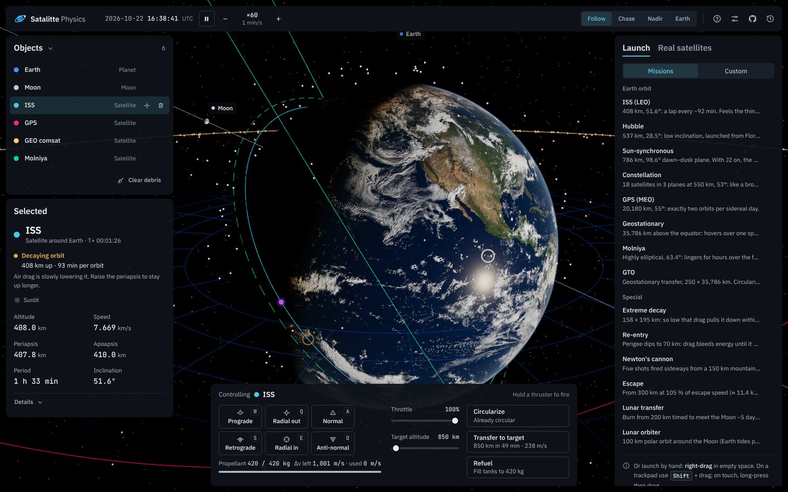
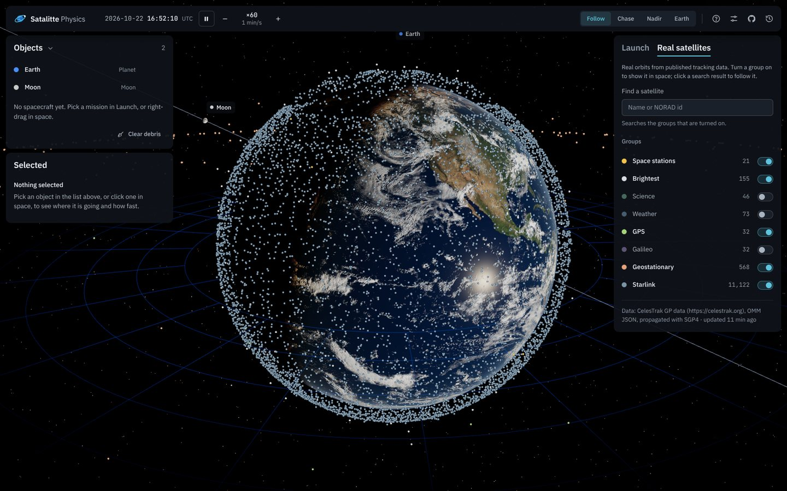
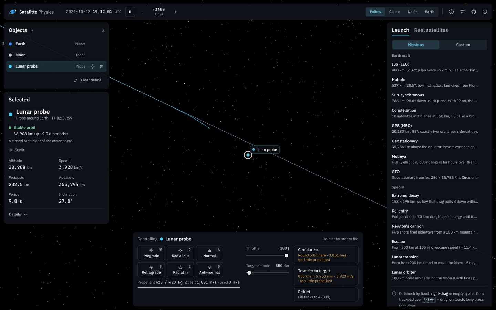
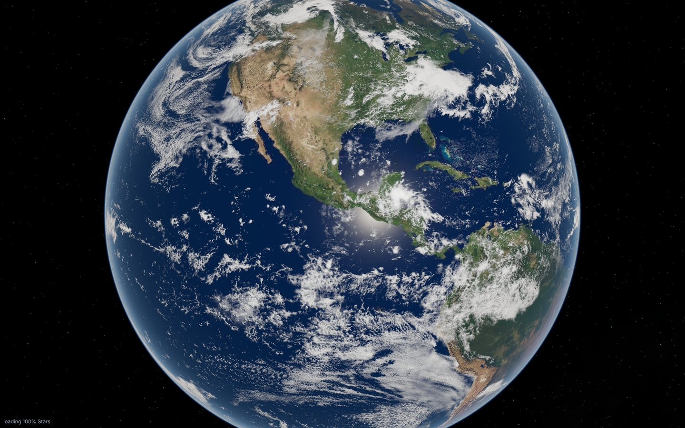
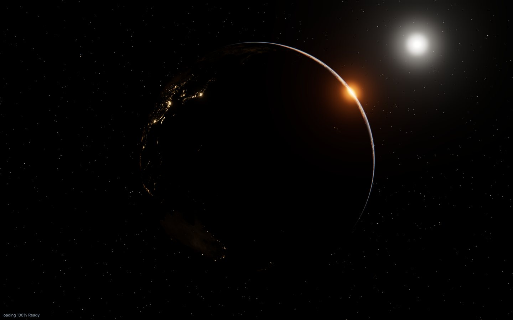
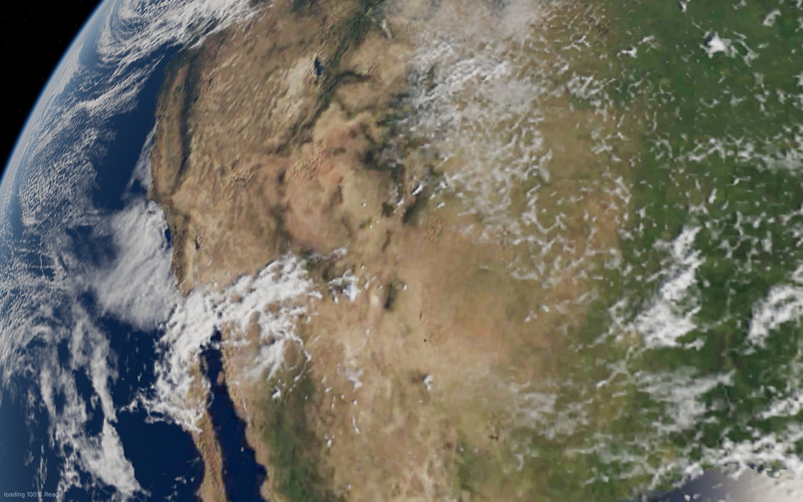
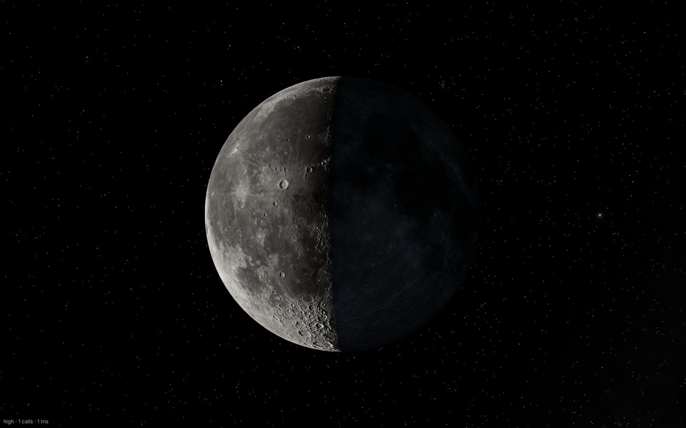

# Satalitte Physics: ORBITAL-OS v2

A real-time **Earth–Moon orbital mechanics sandbox** in the browser. Launch
satellites, fly them with a propellant-limited engine, run Hohmann transfers,
watch drag pull a capsule into a fiery re-entry, slingshot a probe around the
Moon, or follow the real ISS and 11,000 Starlink satellites where they are
right now, all with real physics and a real sky.

**Live:** https://ibra-kdbra.github.io/Satalitte-Physics/ · the original 2021
version is still playable at [`legacy/index.html`](legacy/index.html), and
the ORBITAL-OS prototype at [`legacy/orbital-os.html`](legacy/orbital-os.html).



| | |
|---|---|
|  |  |
| **Real satellites.** Live CelesTrak element sets, SGP4 in a worker; 11,122 Starlink at interactive rates. | **Missions.** A lunar transfer, among 15 presets from the ISS to Newton's cannon. |
|  |  |
| **The Earth by day.** NASA Blue Marble, relief, clouds and physically based scattering. | **The night side.** Black Marble city lights and the reddened terminator. |
|  |  |
| **Up close.** 4K/8K maps with GEBCO relief, loaded progressively. | **The Moon.** LRO LROC imagery, LOLA relief and Lunar-Lambert shading. |

## What's simulated

| | |
|---|---|
| **Gravity** | Newtonian Earth gravity + **J2 oblateness** (nodal precession: sun-synchronous orbits really are sun-synchronous) |
| **Moon and Sun** | Positions from low-precision ephemerides for the simulated date (Moon ≈ 0.3°, Sun ≈ 0.01°); both pull on spacecraft as third bodies, including the indirect (tidal) term |
| **Atmosphere** | Piecewise-exponential density 0–1000 km (Vallado), co-rotating with the Earth; drag decays orbits, heating drives the re-entry glow |
| **Eclipses** | Umbra and penumbra of the Earth and the Moon (conical shadow model): every spacecraft knows whether it is in sunlight |
| **Integrator** | 4th-order symplectic (Yoshida) with per-object adaptive steps; energy is conserved to ~1e-9 over many orbits; time warp up to 1 day per second |
| **Propulsion** | 18 kN engine, Isp 340 s, 420 kg propellant: finite burns at F/m in the local orbital frame, fuel flow F/(Isp·g0); circularize and two-burn Hohmann transfers paid for with the rocket equation |
| **Real satellites** | CelesTrak GP element sets (stations, bright satellites, science, weather, GPS, Galileo, geostationary, Starlink), propagated with SGP4 (satellite.js) in a Web Worker; any of them can be cloned into the sandbox and flown |
| **Sky** | Sun direction (seasons), Earth rotation (GMST) and Moon position match the real date and time, so day/night on the globe is the real one; 25,723 Hipparcos stars |
| **Events** | Impacts (with a marker at the real latitude/longitude), escape from the Earth–Moon system, propellant depletion |

## Graphics and performance

- **Imagery:** NASA Blue Marble Next Generation (up to 8K), Black Marble 2016
  city lights, GEBCO relief, Solar System Scope clouds, NASA SVS LRO LROC Moon
  with LOLA relief, NASA Deep Star Maps Milky Way.
- **Shading:** single-scattering atmosphere (Rayleigh, Mie, ozone) seen from
  space and from low orbit, ocean sun glint, cloud shadows, Lunar-Lambert Moon
  with earthshine, re-entry plasma and impact flashes, PBR spacecraft, bloom.
- **Loading:** about 2.2 MB before the first frame; sharper tiers stream in
  afterwards, the large colour maps as **KTX2** (GPU-compressed: 4–8× less
  video memory), the 4K Moon relief only when you fly to the Moon. Phones get
  a light tier with no upgrades.
- **Frame cost:** render on demand (a paused, still scene is not redrawn),
  adaptive resolution, an allocation-free physics loop; `?perf=1` shows CPU
  time per stage and the GPU's own time per frame.
- **Offline:** a service worker keeps textures and libraries cached; the app
  opens without a network after the first visit.
- **Robust on real GPUs:** shader failures and lost WebGL contexts are
  reported (and the quality steps down) instead of leaving a black screen;
  `tests/visual/gpu-check.html` pins down a misbehaving driver in one screenshot.

## Controls

| Input | Action |
|---|---|
| Left-drag / wheel / pinch | Orbit and zoom the camera around the focused body |
| Click / double-click | Select / focus an object (Earth, Moon or a spacecraft) |
| Right-drag in space (Shift+drag, long-press on touch) | Launch a satellite: the drag sets its velocity; a live orbit preview shows its fate |
| `W` `S` | Prograde / retrograde thrust (hold) |
| `A` `D` | Normal / anti-normal thrust (hold) |
| `Q` `E` | Radial out / radial in thrust (hold) |
| `Space` | Pause / resume |
| `,` `.` | Slower / faster time warp |
| `F` `H` | Focus selection / reset view |
| `Tab` | Cycle through objects |
| `C` | Camera mode: follow → chase → nadir |
| `O` `T` `L` | Toggle orbit predictions, trails, labels |
| `Delete` / `Backspace` | Remove the selected spacecraft |
| `?` | Help |

Presets include the ISS, Hubble, a sun-synchronous imager, an 18-satellite
constellation, GPS, geostationary, Molniya, GTO, extreme decay, re-entry,
Newton's cannon, escape, a lunar transfer and a lunar orbiter.

### Shareable links

| URL option | Effect |
|---|---|
| `?preset=iss,geo` | Start with these presets (ids: iss, hubble, sso, constellation, gps, geo, molniya, gto, decay, reentry, cannon, escape, lunar, lunarOrbit) and focus the first |
| `?empty` | Start with only the Earth and the Moon |
| `?warp=3600` | Initial time warp (1, 10, 60, 300, 1800, 3600, 21600, 86400) |
| `?quality=low` | Force graphics quality (low / medium / high) |
| `?perf=1` | Performance overlay: GPU name, frame time, CPU time per stage, GPU time per frame (where the browser exposes GPU timers), draw calls, triangles, GPU memory |
| `?adaptive=0` / `?adaptive=1` | Adaptive resolution off / on (default: on with a GPU, off on software rendering) |
| `?sw=0` | Do not register the offline cache (service worker) |

Graphics trouble on a particular GPU? `tests/visual/gpu-check.html` draws the
Earth in 14 variants (features off, debug views, NaN probes) side by side; a
screenshot of it pins the failing part down.

## Project layout

```
index.html            entry point (import map, no build step)
styles/main.css       HUD styling
src/main.js           bootstrap, game loop, glue
src/camera.js         follow / fly-to / chase / nadir camera rig
src/input.js          picking, drag-to-launch, keyboard
src/physics/          simulation, orbits, ephemeris, atmosphere, presets (pure JS)
src/render/           three.js scene: Earth shaders, Moon, sky, spacecraft, trails
src/ui/               HUD, instruments (navball, ground track, chart), settings
vendor/               three.js r185 + addons, lil-gui 0.21 (pinned, served locally)
assets/textures/      Earth / Moon / sky textures (JPEG start tiers, KTX2 for the large colour maps)
sw.js                 service worker: offline start, cached textures on repeat visits
src/catalog/          real satellites: CelesTrak data, SGP4 worker
scripts/              texture builds, satellite fetch, vendoring
tests/                unit tests, browser QA, render validation, benchmark, GPU check
legacy/               the 2021 version and the ORBITAL-OS prototype
docs/                 architecture, roadmap, credits, screenshots
```

## Development

No bundler is needed; it's plain ES modules, so GitHub Pages serves it as is.

```bash
python3 -m http.server 8080      # or: npm run serve → http://localhost:8080
npm test                         # physics and SGP4 regression tests (node --test)
npm run qa                       # browser QA of the whole app, 119 checks (needs Playwright)
npm install && npm run vendor    # only when upgrading three.js / lil-gui
node tests/smoke/shot.mjs index.html shot.png 8000   # headless render check (needs Playwright)
npm run bench                    # performance benchmark: CPU per stage, draw calls, bytes, start-up (needs Playwright)
npm run validate:render          # rendering checks with a contact sheet (needs Playwright)
python3 scripts/build-hires-textures.py <sources>   # rebuild the textures from the NASA originals (see the script)
npm run textures:ktx2            # rebuild the KTX2 copies after changing a JPEG
```

### Deployment

GitHub Pages is deployed by `.github/workflows/pages.yml` (Settings → Pages →
*Source: GitHub Actions*). Each run, on every push to `main`, every 6 hours and
on demand, runs the physics tests, fetches fresh satellite element sets from
[CelesTrak](https://celestrak.org) into `data/satellites/` (falling back to the
deployed copy for any group that fails) and publishes the site. The data is
never committed, so the repository stays small. The service worker's cache
version is stamped with a hash of `assets/` and `vendor/`, so visitors
re-download textures only when they change. Everything uses relative paths, so
the site works under the `/Satalitte-Physics/` sub-path.

## Roadmap

Done: the sandbox and its physics, real satellites, graphics and performance.
Next: ground stations and passes, eclipse and power, a maneuver planner,
rendezvous, missions with goals, streamed close-up imagery and today's clouds.
See [`docs/ROADMAP.md`](docs/ROADMAP.md).

Real-satellite data locally: `node scripts/fetch-satellites.mjs` (needs
internet), or `node tests/fixtures/make-satellites.mjs` for synthetic offline
data served with `?satdata=tests/fixtures/satellites/`.

## Credits & references

Textures: NASA Blue Marble Next Generation, Black Marble 2016, GEBCO
topography (Visible Earth), LRO LROC and LOLA (NASA SVS CGI Moon Kit), Deep Star
Maps 2020, Solar System Scope clouds (CC BY 4.0) and Hipparcos stars; full list
and licences in [`docs/CREDITS.md`](docs/CREDITS.md). Physics references are
listed in [`Links for project.txt`](Links%20for%20project.txt) and in the
in-app help.

This project started in 2021 as a from-scratch satellite physics engine; if you
like it or use it, please leave a ⭐ on the repository.
